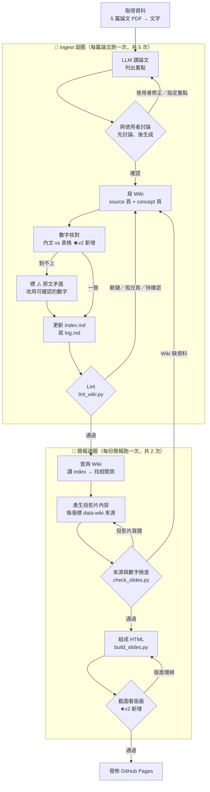

# Loop / Graph 設計

## 流程圖（v2，實際執行後修改過的版本）

## 文字說明

**取得資料 → 查詢 Wiki → 整理重點 → 檢查內容 → 產生簡報**，可以拆成兩個迴圈：

| 階段 | 節點 | 誰做 | 產出 |
|---|---|---|---|
| 取得資料 | PDF 轉文字 | LLM（pdftotext） | `raw/`（只讀） |
| 整理重點 | 讀論文 → 列重點 → **討論** → 寫 Wiki | LLM 寫、人決定重點 | `wiki/sources/`、`wiki/concepts/` |
| 檢查內容 ① | 數字核對、Lint | LLM＋腳本 | ⚠️ 標記、`log.md` |
| 查詢 Wiki | 讀 `index.md` 找頁面 | LLM | — |
| 產生簡報 | 依 Wiki 寫投影片 | LLM | `slides/src/*.html` |
| 檢查內容 ② | 來源與數字檢查、截圖 | 腳本＋LLM 看圖 | `process/check-log.md` |

## 哪些步驟會重複執行？
1. **Ingest 迴圈**：每篇論文跑一次（共 5 次）。每次都會回頭改 concept 頁和 overview，所以 Wiki 會越來越完整，不是 5 份互不相干的摘要。
2. **討論迴圈**：使用者不同意或想換重點時，LLM 重新整理再提一次（例：HoVer 原本問「要挑哪個重點」，使用者改成「完整講解整篇」）。
3. **Lint 迴圈**：沒過就回去改 Wiki，直到通過。
4. **簡報迴圈**：每份簡報跑一次；檢查沒過就改投影片，或回頭補 Wiki。
5. **版面迴圈**：截圖發現版面壞掉 → 改 CSS → 重新 build → 再截圖。

## 哪些地方需要檢查或重新生成？
| 檢查點 | 檢查什麼 | 沒過時回到哪裡 |
|---|---|---|
| 討論 | 重點對不對、是不是使用者要的 | 重新列重點 |
| 數字核對 | 內文、摘要的數字和表格是否一致 | 標 ⚠️，只引用能確認的數字 |
| Lint | 斷鏈、孤兒頁、「待確認」、source 頁 11 段是否齊全 | 改 Wiki |
| 來源與數字檢查 | 每張投影片有沒有標 Wiki 來源；投影片上每個數字是否出現在該 Wiki 頁 | 改投影片；或回 Wiki 補（**不能直接在投影片上補**） |
| 截圖 | 文字溢出、重疊、斷行 | 改 CSS 重新 build |

## 為什麼這樣設計？
- **先討論、後生成**：Wiki 是之後所有簡報的知識來源，重點抓錯會一路錯下去，所以在寫進 Wiki 之前先讓人確認。
- **簡報只能從 Wiki 拿資料**：這樣「Wiki 和簡報對得起來」可以被**機械化檢查**（`data-wiki` ＋ 數字比對），而不是靠人眼。
- **Wiki 缺資料時回到 Ingest，而不是直接在投影片補**：避免簡報出現 Wiki 沒有的內容，破壞對應關係。
- **檢查放在兩層**：`check_slides` 只能確認「簡報 vs Wiki」，確認不了「Wiki vs 原文」。所以原文的錯誤要在 Ingest 時就抓（見反思）。
